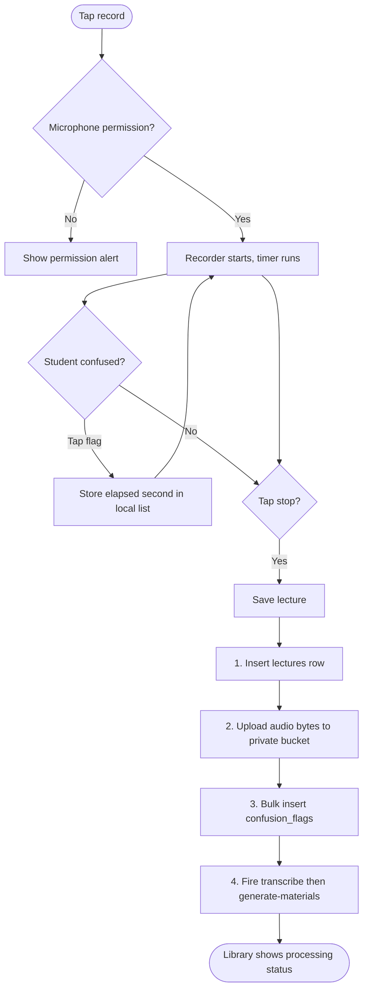
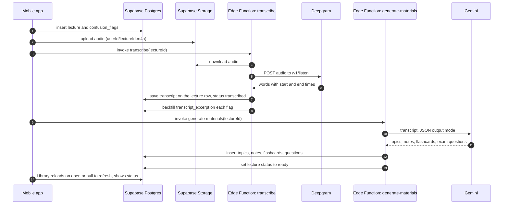
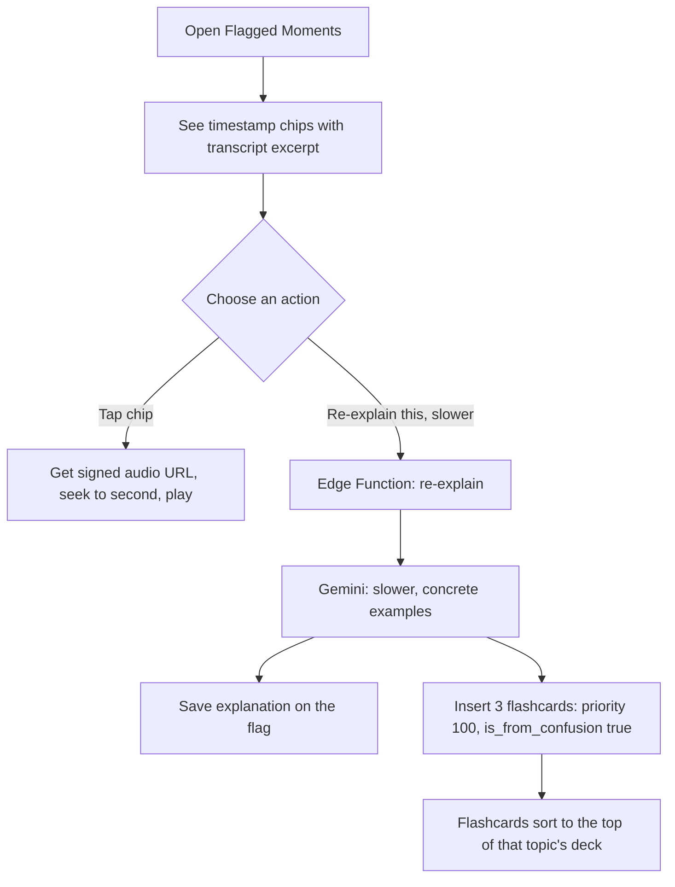
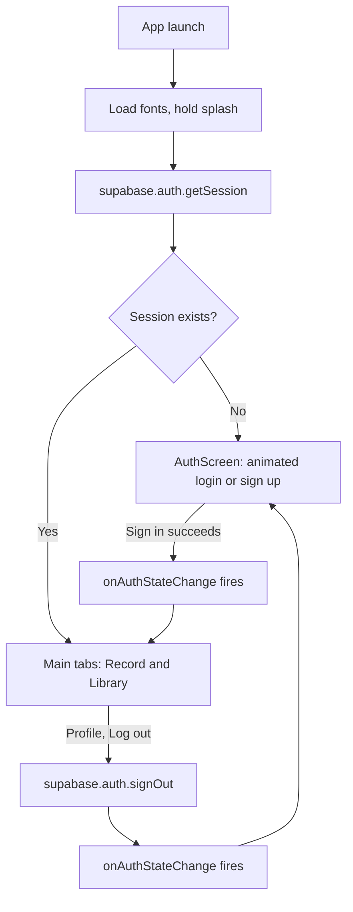
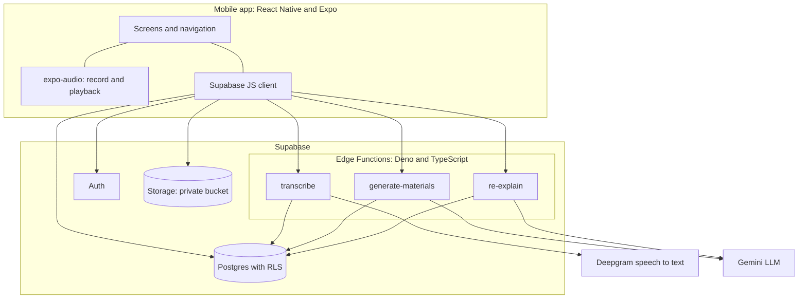
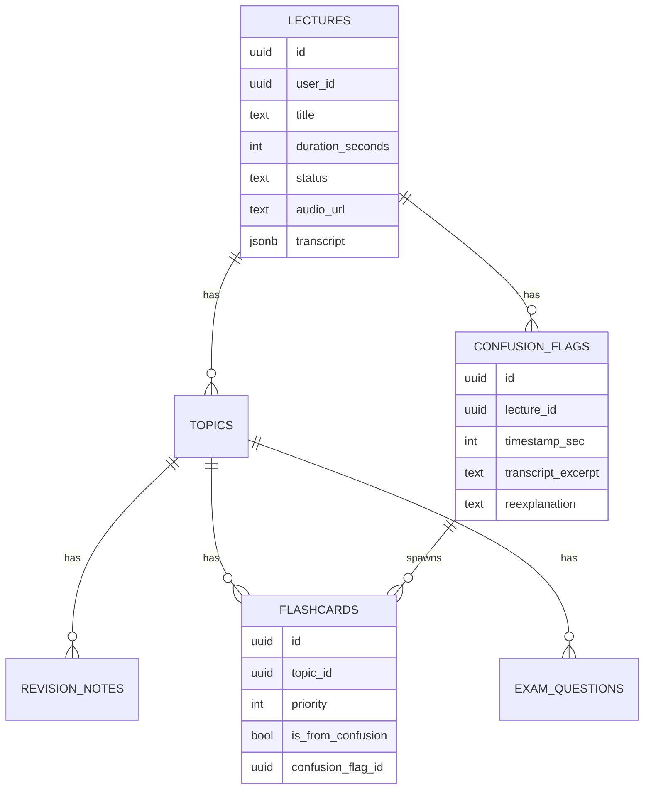
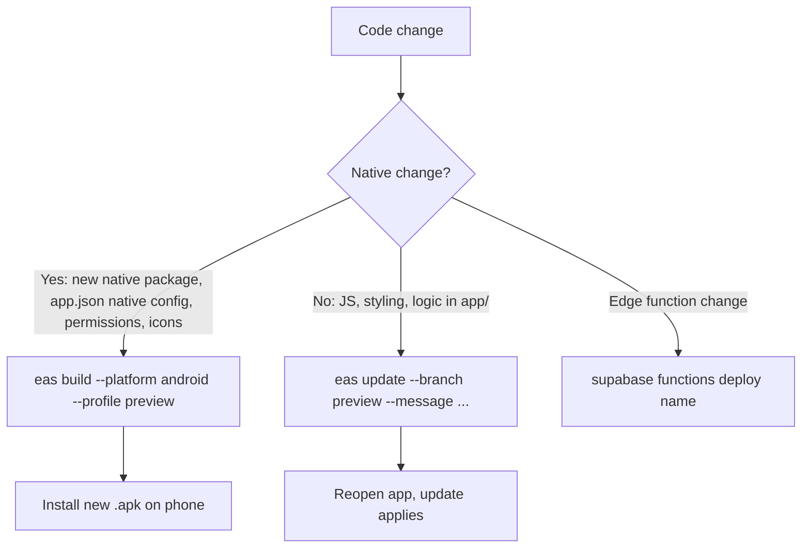

<div align="center">

# BrieflyAI

**Record the lecture. Flag the moment you got lost. Get it explained again, slower.**

An AI lecture companion for students, built with React Native (Expo) and Supabase.


</div>

---

## Table of contents

1. [The problem](#1-the-problem "1. The problem")
2. [Why BrieflyAI](#2-why-brieflyai "2. Why BrieflyAI")
3. [Features](#3-features "3. Features")
4. [How it works](#4-how-it-works "4. How it works")
5. [Architecture](#5-architecture "5. Architecture")
6. [Data model](#6-data-model "6. Data model")
7. [Security design](#7-security-design "7. Security design")
8. [Tech stack](#8-tech-stack "8. Tech stack")
9. [Project structure](#9-project-structure "9. Project structure")
10. [Getting started](#10-getting-started "10. Getting started")
11. [Build and release](#11-build-and-release "11. Build and release")
12. [Key design decisions](#12-key-design-decisions "12. Key design decisions")
13. [Troubleshooting](#13-troubleshooting "13. Troubleshooting")
14. [Limitations and roadmap](#14-limitations-and-roadmap "14. Limitations and roadmap")
15. [License](#15-license "15. License")

---

## 1. The problem

Students lose the thread in lectures. By the time they realise they did not follow a
step, the lecturer has moved on, and the only record of the confusion is a vague memory
("something around the middle of the lecture"). Plain transcripts do not help much:
they are long, unstructured, and treat every minute as equally important.

BrieflyAI is built around one idea: \*\*the moments a student was confused are the most
valuable parts of the lecture to revisit\*\*, so the app should capture them precisely and
put them first.

---

## 2. Why BrieflyAI

Most recording and transcription apps are built for meetings: transcripts, speaker labels,
action items. BrieflyAI is built for *learning*. The table compares the approaches by
category, not by individual product release; feature sets change, so check current
offerings before relying on any single cell.

|                                      | **BrieflyAI**                                                                         | General transcription apps (Otter.ai style) | Voice memo + manual notes       |
| ------------------------------------ | ------------------------------------------------------------------------------------- | ------------------------------------------- | ------------------------------- |
| **Primary goal**                     | Understanding and revision                                                            | Meeting records and action items            | Raw capture                     |
| **Confusion marking**                | One tap, exact second, no interruption to recording                                   | Not a core concept                          | Pause and jot a note, or forget |
| **What happens to a flagged moment** | Transcript excerpt around it, slower example-rich re-explanation, targeted flashcards | Usually just a highlight at best            | Nothing                         |
| **Revision material**                | Topic-wise summaries, revision notes, flashcards, exam questions                      | Summary and transcript                      | Whatever you write yourself     |
| **Revision order**                   | Flashcards from confusing moments are prioritised (`priority: 100`)                   | Not applicable                              | Manual                          |
| **Replay of the confusing part**     | Tap the timestamp chip and the audio seeks there                                      | Scrub the timeline                          | Scrub the timeline              |
| **Organisation**                     | Stored topic-wise per lecture                                                         | Chronological conversations                 | Files by date                   |
| **Data ownership**                   | Your own Supabase project, per-user Row Level Security                                | Vendor-hosted                               | Local files                     |
| **Cost to run**                      | Free tiers cover personal use (Supabase, Deepgram credit, Gemini free tier)           | Subscription tiers                          | Free                            |
| **Customisable**                     | Open source, prompts and schema are yours to change                                   | Closed                                      | Not applicable                  |

**In one line:** other tools answer *"what was said?"*. BrieflyAI answers \*"what did I not
understand, and how do I fix that before the exam?"\*

---

## 3. Features

- **Lecture recording** with a live timer, saved to a private cloud bucket.
- **One-tap confusion flag.** Tap "I'm confused" mid-lecture; the exact timestamp is
  stored locally with zero interruption, then saved with the lecture.
- **Automatic transcription** via Deepgram with word-level timestamps.
- **AI study material** from Gemini: topics, summaries, revision notes, flashcards and
  exam questions, all organised topic-wise.
- **Re-explain this, slower.** For each flagged moment, the LLM produces a slower,
  example-rich explanation plus three flashcards aimed at that exact confusion.
- **Audio playback with seek-to-timestamp.** Tap a flagged moment and hear it again.
- **Flip-card revision deck**, with confusion-derived cards surfaced first.
- **Account management.** Email sign-up, log in, log out, persistent sessions.
- **Calm, focused UI.** Calligraphic "Stay focused, without confusions" tagline, a
  staggered login animation and a breathing focus ring, recording pulse tied to real state.
- **Over-the-air updates** for JavaScript-only fixes through EAS Update.

<!--
Add 3-4 screenshots here once the app is running, e.g.:
<p align="center">
  
  
  
  
</p>
-->

---

## 4. How it works

### 4.1 The big picture

```mermaid
flowchart LR
    A["Student records lecture"] --> B["Taps confusion flag when lost"]
    B --> C["Stops recording"]
    C --> D["Audio + flags saved to Supabase"]
    D --> E["Transcribe: Deepgram"]
    E --> F["Generate materials: Gemini"]
    F --> G["Topics, summaries, notes, flashcards, exam questions"]
    G --> H["Student reviews flagged moments"]
    H --> I["Re-explain slower: Gemini"]
    I --> J["Priority flashcards for confusing parts"]
```



### 4.2 Recording and the confusion flag

The flag never touches the network while recording. The timestamp is read from a `ref`
(so it is always current, never a stale closure value) and held in memory until the
lecture is saved.



### 4.3 Processing pipeline (server side)



### 4.4 Re-explaining a flagged moment



### 4.5 Authentication and navigation

Navigation is driven by auth state, not by manual redirects. Logging out simply clears the
session, and the listener swaps the whole navigator.



---

## 5. Architecture



There is **no custom server to run or pay for**. Supabase provides the database, auth,
file storage and serverless functions; the app only ever talks to Supabase.

---

## 6. Data model



Every table carries a `user_id` and has an RLS policy of the form
`auth.uid() = user_id`. Full schema: [`supabase/migrations/0001_init.sql`](supabase/migrations/0001_init.sql).

---

## 7. Security design

| Concern                        | How it is handled                                                                                                                                             |
| ------------------------------ | ------------------------------------------------------------------------------------------------------------------------------------------------------------- |
| **Third-party API keys**       | Deepgram and Gemini keys exist only as Supabase secrets (`supabase secrets set`). They are never in the app bundle, because a compiled app can be decompiled. |
| **Who can read or write data** | Postgres Row Level Security on every table: `auth.uid() = user_id`. Enforced in the database, not in app code.                                                |
| **Audio files**                | Private Storage bucket with per-user folder policies. Playback uses a signed URL that expires after one hour.                                                 |
| **Client key**                 | The Supabase `anon` key is designed to be public; RLS decides what it can actually touch. The `service_role` key is never used in the app.                    |
| **Repository hygiene**         | `.env*`, build output and signing keys are in `.gitignore`.                                                                                                   |

> **Never paste an API key into a chat, issue or commit.** If one leaks, revoke it
> immediately and create a new one.

---

## 8. Tech stack

| Layer          | Technology                                           | Why                                                         |
| -------------- | ---------------------------------------------------- | ----------------------------------------------------------- |
| App framework  | Expo SDK 57, React Native 0.86, React 19             | One codebase for Android and iOS, cloud builds, OTA updates |
| Navigation     | React Navigation (bottom tabs and native stacks)     | Nested stacks per tab, auth-gated root                      |
| Audio          | `expo-audio`                                         | Recorder and player hooks (replaces deprecated `expo-av`)   |
| File I/O       | `expo-file-system` (`File` class)                    | Reads recorded audio as raw bytes, no base64 round trip     |
| Animation      | React Native `Animated`                              | Native-driver animations, no extra dependency               |
| Typography     | Plus Jakarta Sans and Dancing Script via `expo-font` | Clean body text, one calligraphic accent                    |
| Backend        | Supabase (Postgres, Auth, Storage, Edge Functions)   | Relational data, RLS, serverless in one platform            |
| Speech to text | Deepgram `nova-2`                                    | Word-level timestamps, generous free credit                 |
| LLM            | Gemini (`gemini-3.1-flash-lite`)                     | Free tier, JSON output mode                                 |
| Delivery       | EAS Build and EAS Update                             | Installable `.apk` and instant JS-only fixes                |

---

## 9. Project structure

```
BrieflyAI/
├── App.js                           # entry: font loading, splash hold, root navigation
├── app.json                         # Expo config (Supabase URL and anon key)
├── eas.json                         # build and update channels
├── app/
│   ├── screens/
│   │   ├── AuthScreen.js            # animated login and sign up
│   │   ├── RecordScreen.js          # recording and one-tap confusion flag
│   │   ├── LibraryScreen.js         # lecture list and processing status
│   │   ├── LectureDetailScreen.js   # topics and link to flagged moments
│   │   ├── TopicDetailScreen.js     # summary, notes, flashcards, exam questions
│   │   ├── ConfusionReviewScreen.js # audio seek and re-explanations
│   │   └── ProfileScreen.js         # account and log out
│   ├── components/FlashcardDeck.js  # flip-card revision deck
│   ├── lib/supabase.js              # client, edge function callers, signed URLs
│   ├── navigation/index.js          # auth-gated tabs and stacks
│   └── constants/theme.js           # colours, fonts
└── supabase/
    ├── migrations/0001_init.sql     # schema, RLS policies, storage bucket
    └── functions/
        ├── transcribe/              # Deepgram transcription and excerpt backfill
        ├── generate-materials/      # Gemini: topics, notes, flashcards, questions
        └── re-explain/              # Gemini: slower explanation and priority cards
```

---

## 10. Getting started

### Prerequisites

- Node.js 18 or newer
- A free [Supabase](https://supabase.com) project
- A free [Deepgram](https://console.deepgram.com) API key (includes starting credit)
- A free [Gemini](https://aistudio.google.com) API key
- The [Supabase CLI](https://supabase.com/docs/guides/cli) and an [Expo](https://expo.dev) account

### Step 1: Clone and install

```bash
git clone https://github.com/manju-muru/BrieflyAI.git
cd BrieflyAI
npm install
```

### Step 2: Create the database

In the Supabase **SQL Editor**, run `supabase/migrations/0001_init.sql`. It creates the
tables, RLS policies and the private `lecture-audio` bucket. Make sure Email auth is
enabled under **Authentication, Providers**.

### Step 3: Deploy the Edge Functions

```bash
supabase login
supabase link --project-ref YOUR_PROJECT_REF

supabase secrets set DEEPGRAM_API_KEY=your_deepgram_key
supabase secrets set GEMINI_API_KEY=your_gemini_key

supabase functions deploy transcribe
supabase functions deploy generate-materials
supabase functions deploy re-explain
```

Confirm with `supabase secrets list` (it shows names, never values).

### Step 4: Point the app at your project

In `app.json`, set your own values under `extra`:

```json
"extra": {
  "supabaseUrl": "https://YOUR_PROJECT_REF.supabase.co",
  "supabaseAnonKey": "YOUR_ANON_KEY"
}
```

Also replace the `eas.projectId` and `updates.url` values by running `eas init`
with your own Expo account.

### Step 5: Run it

```bash
npx expo start
```

Scan the QR code with **Expo Go** for the quickest test. Because the app uses native
modules and an `.apk` build is the intended way to run it, see the next section for a
standalone install.

---

## 11. Build and release



```bash
# Installable Android build
npm install -g eas-cli
eas login
eas build --platform android --profile preview

# Instant JavaScript-only fix, no rebuild
eas update --branch preview --message "Describe the fix"
```

When the build finishes, open the URL it prints in your **phone's browser** and download
the `.apk`. You may need to allow installs from unknown sources once.

---

## 12. Key design decisions

| Decision                                                                     | Reasoning                                                                                                                                                                           |
| ---------------------------------------------------------------------------- | ----------------------------------------------------------------------------------------------------------------------------------------------------------------------------------- |
| **Supabase instead of Firebase**                                             | The data is relational (lecture → topics → flashcards), RLS gives database-level authorisation, and Auth, Storage and functions come in one free-tier platform.                     |
| **Edge Functions instead of calling AI APIs from the app**                   | Keeps third-party keys off the device. The app holds only the public anon key, and RLS controls what it can touch.                                                                  |
| **Deepgram instead of Google Speech-to-Text**                                | Simple REST call with raw audio, word-level timestamps (needed to map a flag to its transcript), and free starting credit.                                                          |
| **Gemini instead of a paid LLM**                                             | A free tier with no card required suits a student project; JSON output mode makes the structured results reliable to parse.                                                         |
| **Auth-state-driven navigation**                                             | One `onAuthStateChange` listener handles login, logout and session restore, with no scattered redirect logic.                                                                       |
| **Flag timestamps held in a `ref`**                                          | Always reads the current second, avoiding the stale-closure bug a state variable would cause inside the tap handler.                                                                |
| **Fire-and-forget processing, Library reloads on focus and pull-to-refresh** | The student is never stuck on a loading screen while a long lecture is transcribed; status moves `uploaded` → `transcribing` → `transcribed` → `generating` → `ready` (or `error`). |
| **Signed URLs for playback**                                                 | The bucket stays private; links expire after an hour.                                                                                                                               |
| **`expo-audio` and the `File` API**                                          | `expo-av` and the old string-based file API are deprecated; the new ones read bytes directly.                                                                                       |
| **Upgrade to SDK 57**                                                        | Fixed a Gradle autolinking build failure present in older SDKs.                                                                                                                     |

---

## 13. Troubleshooting

| Symptom                                                   | Cause and fix                                                                                                                                            |
| --------------------------------------------------------- | -------------------------------------------------------------------------------------------------------------------------------------------------------- |
| Lecture stuck on "Queued" or "Generating"                 | Edge functions are not deployed (common after replacing the project folder). Run the three `supabase functions deploy` commands.                         |
| `API key not valid` from Gemini                           | The secret was set with a bad copy. Re-copy the key, run `supabase secrets set GEMINI_API_KEY=...`, then redeploy `generate-materials` and `re-explain`. |
| `Cannot find module 'babel-preset-expo'` during EAS build | Add `babel-preset-expo` to `devDependencies`.                                                                                                            |
| `Unable to resolve module punycode`                       | Add `punycode` as an explicit dependency.                                                                                                                |
| `readAsStringAsync is deprecated`                         | Use `new File(uri).bytes()` from `expo-file-system`.                                                                                                     |
| `Could not get unknown property 'release'` (Gradle)       | Known autolinking bug in older Expo SDKs ([expo/expo#38350](https://github.com/expo/expo/issues/38350)). Upgrade to the current SDK.                     |
| Build fails with `ETIMEDOUT`                              | Network problem, not a code problem. Check the connection and retry.                                                                                     |
| Changes not showing after `eas update`                    | The change touched native config or dependencies; do a full `eas build` instead.                                                                         |

---

## 14. Limitations and roadmap

**Current limitations**

- Recording needs a network connection to upload; there is no offline queue yet.
- Very long recordings are sent in one request; splitting client-side would be more robust.
- Free-tier rate limits apply to Gemini and Deepgram credit.

**Ideas for next steps**

- [ ] Offline recording with background upload
- [ ] Spaced-repetition scheduling for flashcards
- [ ] Share a lecture's notes with classmates
- [ ] Multi-language transcription
- [ ] Export notes to PDF
- [ ] Live status updates (Supabase Realtime) or a push notification when processing finishes

---

## 15. License

Released under the [MIT License](LICENSE).
